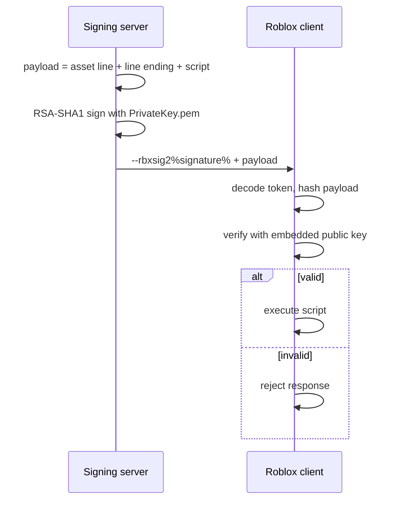

#  rbxsig-php

One PHP library for two jobs:

- generating RSA key pairs for Roblox script signing (PEM keys + CSP public key blob)
- signing Lua scripts in the Roblox `%...%` / `--rbxsig` / `--rbxsig2` / `--rbxsig4` formats

Signing is RSA/SHA-1 over the exact payload that follows the signature token. The payload is normally `\r\n` + the script, and may optionally include an `--rbxassetid%...%` line.

## How Roblox script signing works



The token and its wrapper are **not** signed; the bytes after the closing `%`
are. That is why line endings and the optional asset-ID line must be preserved
exactly. Script signing authenticates the response; it does not encrypt the
script or act as anti-cheat.

The full guide covers the [byte layout, key encodings, threat model, format
evolution, and history](docs/script-signing.md), including the 2009-era
join-script motivation and a timeline from the classic `%...%` wrapper through
`--rbxsig4`.

To point an archived client's signature verification at your own key, see the
[public-key patching guide](docs/patching-public-keys.md). It covers the `BgIAA`
Base64 search, the raw CSP blob header, key-size/field-length checks, HxD steps,
and rollback. The guide is for archived clients only, not current official
Roblox clients.

## Requirements

- PHP 8.1+
- `ext-openssl`

## Installation

```bash
composer require uv1c/rbxsig-php
```

For a local checkout:

```bash
composer install
```

## Quickstart (CLI)

```bash
# 1. Generate a 2048-bit key pair in ./keys
php bin/rbxsign.php keys:generate --bits 2048 --out-dir keys

# 2. Sign a script for a 2018+ client
php bin/rbxsign.php sign \
  --key keys/PrivateKey.pem \
  --script script.lua \
  --format rbxsig2 \
  --out signed.lua

# 3. Verify the result
php bin/rbxsign.php verify \
  --signed signed.lua \
  --public-key keys/PublicKey.pem
```

Generated files:

```text
keys/PrivateKey.pem       PKCS#1 private key (keep secret)
keys/PublicKey.pem        PKCS#1 public key (for verification/tools)
keys/PublicKeyBlob.txt    base64-encoded Windows CSP PUBLICKEYBLOB
```

The private key is written last, after the public key and blob, so an interrupted run does not leave a private key without its public pair. Existing files are not overwritten unless you pass `--force`.

For pre-2018 clients, generate a separate 1024-bit pair in its own directory (the exact filenames are reused, so do not mix sizes in one directory):

```bash
php bin/rbxsign.php keys:generate --bits 1024 --out-dir keys/legacy-1024
```

Use `keys/legacy-1024/PrivateKey.pem` with `--format classic` or `--format rbxsig`, and the 2048-bit pair with `rbxsig2` / `rbxsig4`.

## Library usage

### Generate a key pair in memory

```php
<?php

require 'vendor/autoload.php';

use RobloxSigner\Keys\KeyGenerator;
use RobloxSigner\Keys\KeySize;

$generator = KeyGenerator::create();
$keys = $generator->generate(KeySize::bits2048());

$privateKeyPem = $keys->getPrivateKeyPem();
$publicKeyPem  = $keys->getPublicKeyPem();
$publicKeyBlob = $keys->getPublicKeyBlob();        // raw bytes
$publicKeyBlobBase64 = $keys->getPublicKeyBlobBase64();
```

### Generate and export to files

```php
<?php

use RobloxSigner\Keys\KeyGenerationRequest;
use RobloxSigner\Keys\KeyGenerationService;
use RobloxSigner\Keys\KeySize;
use RobloxSigner\Keys\OutputFileNames;

$service = KeyGenerationService::create();

$keyPair = $service->generate(new KeyGenerationRequest(
    KeySize::bits2048(),
    OutputFileNames::fromDirectory('keys')
));
```

Use `new KeyGenerationRequest($keySize, $fileNames, true)` to overwrite existing files.

### Sign a script

```php
<?php

use RobloxSigner\SignatureFormat;
use RobloxSigner\Signer;

$script = file_get_contents('script.lua');

// Sign with the generated private key PEM, no temporary file needed.
$signed = Signer::signWithPem($script, $privateKeyPem, SignatureFormat::RBXSIG2);

header('Content-Type: text/plain');
echo $signed;
```

Path-based signing is still available:

```php
$signed = Signer::sign($script, 'keys/PrivateKey.pem', SignatureFormat::RBXSIG2);
$signed = Signer::signFile('script.lua', 'keys/PrivateKey.pem', 'v2019');
```

### Sign inline Lua (no .lua file)

`sign()` resolves a private key automatically. For `classic` / `rbxsig` it
tries `keys/legacy-1024/PrivateKey.pem`, then `keys/PrivateKey.pem`; for
`rbxsig2` / `rbxsig4` it uses `keys/PrivateKey.pem`. Paths are relative to the
working directory. Pass a path as the third argument or set
`RBXSIG_PRIVATE_KEY` to override.

```php
<?php

require 'vendor/autoload.php';

use function RobloxSigner\sign;

ob_start();
?>
print("player joined the game")
<?php
$script = ob_get_clean();

try {
    echo sign($script, 'pre2012');
} catch (Exception $e) {
    error_log("Script signing failed: " . $e->getMessage());
    http_response_code(500);
    die("Internal Server Error");
}
```

`pre2012`, `pre_2012`, `v2013`-`v2020`, and the four format names are accepted.
See `example/sign-inline.php` for a runnable copy.

### Verify

```php
use RobloxSigner\Verifier;

$valid = Verifier::verify($signed, $publicKeyPem); // true
```

For token-only / HTTP-header signatures:

```php
use RobloxSigner\SigningOptions;

$options = new SigningOptions(
    SignatureFormat::RBXSIG2,
    SigningOptions::LINE_ENDING_CRLF,
    null,
    false // includeScript = false
);

$token = Signer::signWithOptions($script, $privateKeyPem, $options);
$valid = Verifier::verifyPayload("\r\n" . $script, $token, $publicKeyPem);
```

## Formats

| Format | Wrapper | Typical keys | Era |
|---|---|---|---|
| `classic` | `%<base64>%` | 1024-bit | 2009-2013 |
| `rbxsig` | `--rbxsig%<base64>%` | 1024-bit | 2013+ |
| `rbxsig2` | `--rbxsig2%<base64>%` | 2048-bit | 2018+ |
| `rbxsig4` | `--rbxsig4%<base64>%` | 2048-bit | 2020+ |

These boundaries are approximate and come from community documentation. The exact client build is what matters. Use `SignatureFormat` directly when you know which wrapper the target client expects.

Era names map to formats as follows:

```text
pre_2012 -> classic
v2013    -> rbxsig
v2017    -> rbxsig
v2018    -> rbxsig2
v2019    -> rbxsig2
v2020    -> rbxsig4
```

## Line endings and asset IDs

Roblox signs the exact bytes after the signature token. The default payload is:

```text
\r\n<script>
```

Some clients use `\n` instead. Use `SigningOptions::LINE_ENDING_LF` if needed. Do not normalize line endings after signing.

For loadscripts that require an asset ID, pass it to `SigningOptions`; the signed payload becomes:

```text
--rbxassetid%123456%\r\n<script>
```

and the output begins with the signature token immediately followed by the asset ID line:

```text
--rbxsig2%<base64>%--rbxassetid%123456%
<script>
```

## Windows notes

- PHP on Windows often cannot find `openssl.cnf`. The key generator automatically checks for `extras/ssl/openssl.cnf` next to the PHP binary. If your PHP build keeps the file elsewhere, set `OPENSSL_CONF` or pass the path to `KeyGenerator::create($configPath)` / `KeyGenerationService::create($configPath)`.
- `chmod(0600)` does not change NTFS ACLs. Keep private keys outside the web root and protect the directory with Windows permissions.
- `--force` uses a best-effort replace on Windows. Never overwrite a private key that is already in use; generate a new pair instead.

## Security notes

- Never commit `PrivateKey.pem` or expose key generation over HTTP.
- Keep the private key outside the web root and readable only by the process that signs scripts.
- Do not expose a signing endpoint that accepts arbitrary paths or content without authentication and a whitelist.
- SHA-1 and RSA PKCS#1 v1.5 are required by this protocol. FIPS-mode OpenSSL configurations may refuse SHA-1.
- Custom keys only work with clients/servers you own or are authorized to modify.
- If a private key leaks, rotate the key pair and update the public key in the client.

## Examples

- `docs/script-signing.md` - protocol flow, byte layout, key encodings, history, and diagrams.
- `docs/patching-public-keys.md` - hex-editor guide for archived clients.
- `example/sign-script.php` - sign a script file.
- `example/sign-inline.php` - inline Lua without a separate `.lua` file.
- `example/pipeline.php` - generate, sign, and verify in one run.

```bash
php example/pipeline.php
```

## Testing

```bash
composer install
composer test
```

The suite generates throw-away keys at runtime, so no private keys are stored in the repository. It covers all four signature formats, key generation for 1024- and 2048-bit keys, the DER/PEM/CSP encoders, CLI parsing, and an end-to-end generate → sign → verify pipeline.

## License

MIT
