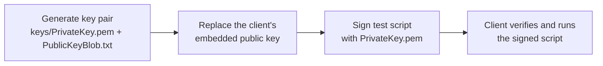

# Patching a client's embedded public key

> **Intended scope: archived, no-longer-updated clients.** This guide is for
> private-server projects running old Roblox client builds that no longer
> receive official updates. It is not for current official Roblox clients.
>
> The goal is to keep the client's signature verification and point it at a key
> pair you control. Do not distribute modified client binaries. This guide does
> not cover bypassing anti-cheat, DRM, or integrity checks.

Based on the [Unofficial Boomblox Wiki: Patching:PublicKey](https://uboomblox.miraheze.org/wiki/Patching:PublicKey)
page (CC BY-SA 4.0), with added length checks and safety notes. The source
covers 2009M (`v0.13.17.0`) through modern builds; this guide applies the
workflow only to archived clients. Treat the steps as a search workflow, not
fixed offsets.

## Why this is needed

Old clients trust Roblox's embedded public key and signing infrastructure. A
private-server project cannot use that infrastructure or Roblox's private key,
so the client cannot validate scripts signed by the project.

Signing cannot simply be patched out of a client that has it. From 2009M
(`v0.13.17.0`) onward, verification is part of the script-loading path, and the
embedded public key is its trust anchor. Replacing that key keeps verification
intact: the client still checks every signed script, but against your key. It
also lets the project rotate keys if the private one is compromised.

Clients older than 2009M predate signing and accept unsigned scripts by design.
That is a property of those builds, not something you can achieve by patching a
signing-capable client; they are outside this guide's scope.

## What patching changes

A signed script is verified with a public key embedded in the client. Replace
that key with the matching `PublicKeyBlob.txt` to make the client accept scripts
signed by your private key.



The signing algorithm is unchanged. The client still verifies RSA/SHA-1
signatures; it simply trusts a different key pair. The private key never goes
into the client.

## Before you start

1. Confirm you have an **archived client build**, not a current official client.
2. Work on a **backup copy** and record the original version and file hash.
3. Check how the key is stored:
   - **ASCII Base64** (common): search for `BgIAA`.
   - **Raw bytes**: search for the hex header below.
4. Match the key size to the existing field. A mismatched length is the most
   common cause of crashes and corruption.

You need a hex editor (this guide uses [HxD](https://mh-nexus.de/en/hxd/)), a
key pair generated by this library, and a test script.

## Key sizes and field lengths

A CSP public-key blob is a 20-byte header followed by the RSA modulus. The
header starts with:

```text
42 67 49 41 41
```

In Base64, that prefix begins with `BgIAA...`.

| Key size | Raw blob | Base64 text | Base64 padding | Typical use |
|---|---:|---:|---|---|
| 1024-bit | 148 bytes | 200 characters | `==` | classic / rbxsig |
| 2048-bit | 276 bytes | 368 characters | none | rbxsig2 / rbxsig4 |

**The replacement must be the same length as the old field.** A 368-character
2048-bit key pasted over a 200-character 1024-bit field will overwrite the
bytes that follow it. Use a key that matches the build, or a build designed for
the larger key. Never truncate a key to make it fit.

## Workflow: ASCII Base64 key in HxD

### 1. Generate the matching key pair

For a 1024-bit build:

```bash
php bin/rbxsign.php keys:generate --bits 1024 --out-dir keys/legacy-1024
```

For a 2048-bit build:

```bash
php bin/rbxsign.php keys:generate --bits 2048 --out-dir keys
```

`PublicKeyBlob.txt` is the Base64 key that goes into the client. Keep
`PrivateKey.pem` on the signing server.

### 2. Find the key

Open the backup copy in HxD and search (`Ctrl+F`) for `BgIAA`. Search the whole
file. The field should start with `BgIAA` and end with `=` or `==`.

There may be several matches. Check the decoded header or surrounding bytes
before patching; do not use the first match blindly.

### 3. Check the field length

Select from the leading `B` through the final `=`, without the NUL terminator
or any following bytes. HxD shows the selected byte count in its status bar.

```text
... BgIAAACkAABSU0Ex...old-key-bytes...== \0 ...
    └──────── old 1024-bit Base64 key ────────┘
```

If the length does not match your key, stop.

### 4. Paste the new key

1. Copy the entire contents of `PublicKeyBlob.txt`.
2. Select exactly the old Base64 field in HxD.
3. Paste, then confirm the replacement matches the selection length and the
   trailing NUL is unchanged.
4. Save; use **Save As** if you want to keep the original separate.

Never use the illustrative values above as a real key.

### 5. Verify

1. Sign a test script with the matching private key:

   ```bash
   php bin/rbxsign.php sign \
     --key keys/PrivateKey.pem \
     --script test.lua \
     --format rbxsig2 \
     --out test-signed.lua
   ```

   Match the key and format to the build. For the older 200-character field,
   use `keys/legacy-1024/PrivateKey.pem` with `--format rbxsig` or `classic`.

2. Verify locally with `PublicKey.pem`:

   ```bash
   php bin/rbxsign.php verify \
     --signed test-signed.lua \
     --public-key keys/PublicKey.pem
   ```

3. Run the patched client and load the signed script.
4. Confirm that a tampered or unsigned copy is rejected. That shows the client
   is using the patched key, not a cached or fallback one.
5. If the client crashes or rejects the script, restore the original and
   re-check the length, key size, and selected bytes.

## Workflow: raw binary blob

Some builds store the blob as raw bytes. Decode `PublicKeyBlob.txt` to a binary
file first.

PowerShell:

```powershell
$base64 = (Get-Content -Raw .\keys\PublicKeyBlob.txt).Trim()
[IO.File]::WriteAllBytes(
    (Join-Path $PWD 'keys\PublicKeyBlob.bin'),
    [Convert]::FromBase64String($base64)
)
```

PHP:

```bash
php -r "file_put_contents('keys/PublicKeyBlob.bin', base64_decode(trim(file_get_contents('keys/PublicKeyBlob.txt'))));"
```

Search for:

```text
06 02 00 00 00 A4 00 00 52 53 41 31
```

Select the entire old blob (148 bytes for 1024-bit, 276 bytes for 2048-bit; the
4-byte bit length follows the `RSA1` marker). Replace it with the same number of
bytes from `PublicKeyBlob.bin`, then verify as above.

## Troubleshooting

| Symptom | Likely cause |
|---|---|
| `BgIAA` is not found | The build stores raw bytes, uses a UTF-16 or otherwise encoded string, or the key is inside a compressed/encrypted resource. Search for the raw header or check the exact client version. |
| Several `BgIAA` matches | More than one key or unrelated Base64 data. Compare the decoded modulus and surrounding bytes. |
| Client crashes on launch | Wrong field length, wrong key size, or bytes overwritten past the field. Restore the backup and re-check the selection. |
| Client runs but rejects signed scripts | Wrong key pair, format, or line ending, or the client checks another key. Verify the script locally first. |
| Patch disappears after an update | You are patching an actively updated build. This guide is scoped to archived clients. |
| Client has an integrity check | Stop here. This guide does not bypass integrity, anti-cheat, or DRM checks. |

## Security notes

- Keep `PrivateKey.pem` out of the client, the web root, and version control.
- Do not remove or bypass signature verification; the point is to preserve the
  trust chain with your key.
- Back up the client and key pair. A lost private key cannot be recreated, and a
  leaked one lets someone else sign content for that client.
- Only modify clients you own or are authorized to operate.

## Reference

- [Unofficial Boomblox Wiki - Patching:PublicKey](https://uboomblox.miraheze.org/wiki/Patching:PublicKey) (CC BY-SA 4.0)
- [How Roblox script signing works](script-signing.md)
