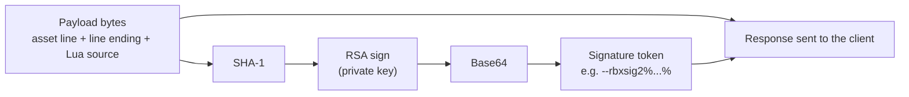
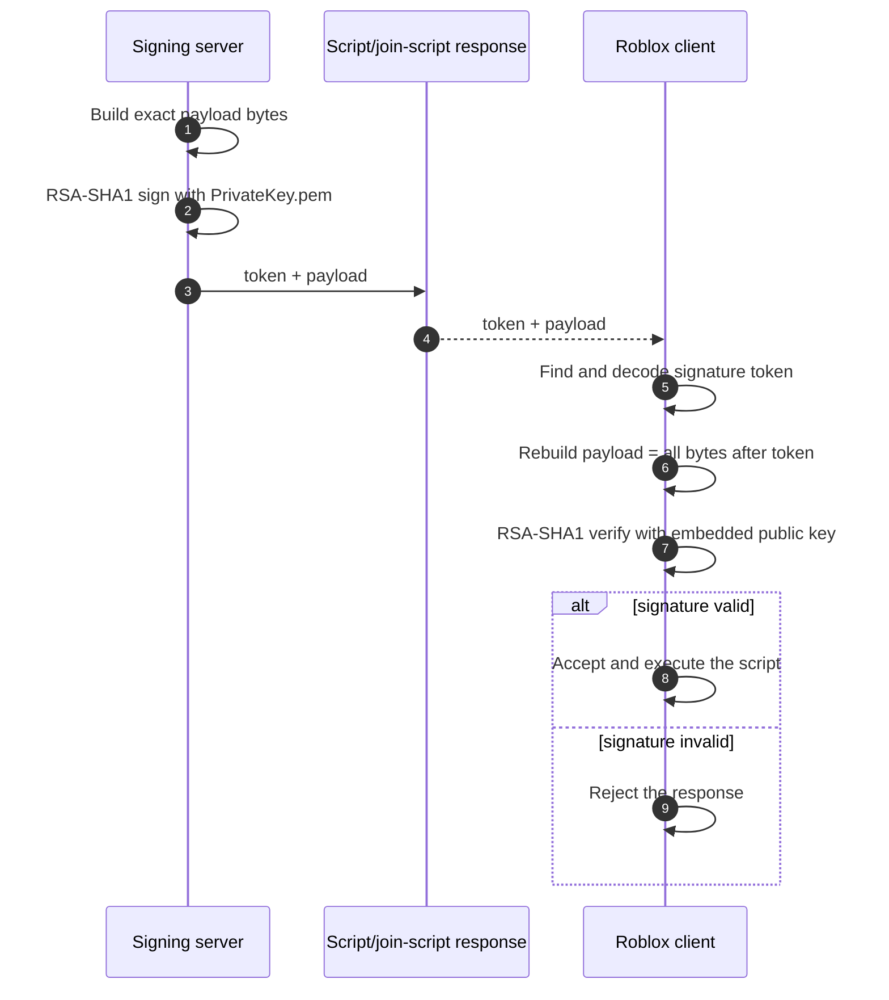
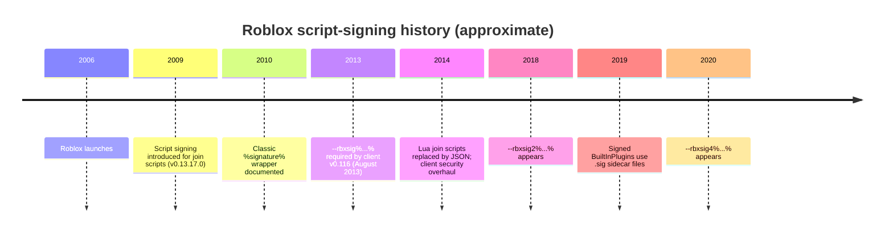
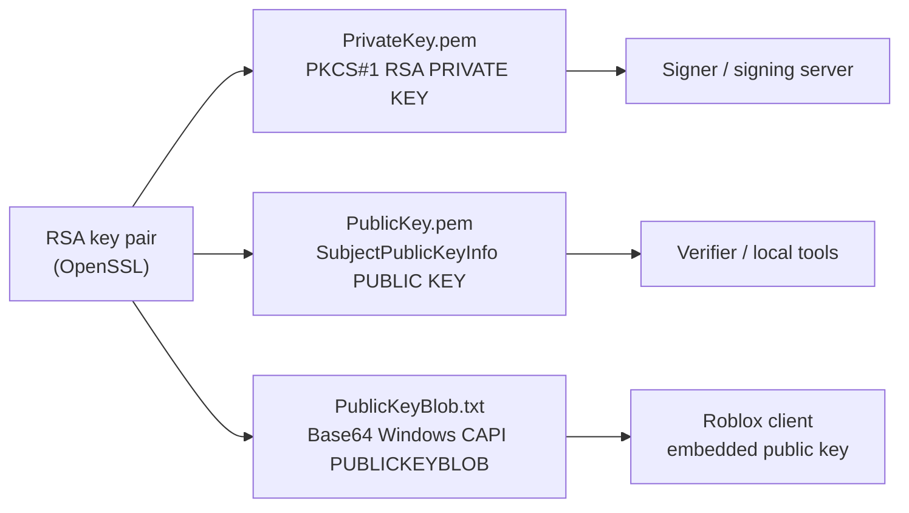

# How Roblox script signing works

> **Scope:** This document describes the legacy inline script-signature formats
> supported by `rbxsig-php`. Roblox has not published a complete public
> specification for them, so the historical details below come from community
> reverse-engineering and are approximate. The exact client build matters more
> than the calendar year.

## Why Roblox signs scripts

Roblox clients receive executable content from Roblox infrastructure: join
scripts, CoreScripts, and other responses that tell the client what to load and
where to connect. If a client accepted any response that looked like Lua, an
attacker who could intercept or replace that response could:

- point the client at a server they control,
- inject arbitrary Lua into the session,
- impersonate Roblox-authored content, or
- forge a join script that impersonates another user, including a nonexistent account, or grants access to a private place.

Script signing is the trust boundary that prevents that. Roblox signs the exact
bytes it sends with a **private key** that stays on Roblox infrastructure. The
client contains only the matching **public key**, so it can verify a signature
but cannot create a new one.

Community documentation places the introduction of signing at **around 2009**
(client `v0.13.17.0`) and names join scripts as the original motivation. The
same mechanism was used for trusted CoreScripts and related content. This is the
"stop people from writing their own join scripts" problem: a custom join script
is just bytes until the client can prove that Roblox produced it.

## The core idea



Signing and verification are asymmetric:



The private key never goes to the client. The public key is not a secret; it is
embedded in the client or distributed to tools that need to verify output.

## Exact byte layout

The signature covers **the payload only**. The wrapper and Base64 signature are
not part of the signed payload.

```text
With an asset ID (spaces are shown only to separate the regions):

--rbxsig2%<base64 signature>% --rbxassetid%123456% \r\n print("hello")
|---------- token ----------| |------------- signed payload --------------|

Without an asset ID:

--rbxsig4%<base64 signature>% \r\n print("hello")
|---------- token ----------| |---- signed payload ----|
```

There are no spaces at the region boundaries in the real response. The token is
immediately followed by the payload bytes.

With the default `rbxsig2` wrapper, the pieces are:

| Piece | Part of signed payload? | Notes |
|---|---|---|
| `--rbxsig2%` | no | Format prefix |
| Base64 signature | no | Raw RSA signature bytes, Base64-encoded |
| closing `%` | no | End of token |
| `--rbxassetid%123456%` | yes | Optional first line |
| `\r\n` or `\n` | yes | Must be preserved exactly |
| Lua source | yes | Every byte, including the final newline |

That is why the library never normalizes line endings after signing. A single
changed byte makes verification fail.

## Signature formats over time

All four wrappers carry the same kind of RSA/SHA-1 signature; the prefix changed
as Roblox updated its clients.

| Library name | Wrapper | Typical key | Approximate use |
|---|---|---|---|
| `classic` | `%<base64>%` | 1024-bit | Late 2000s through 2013 |
| `rbxsig` | `--rbxsig%<base64>%` | 1024-bit | From 2013; still accepted by some clients |
| `rbxsig2` | `--rbxsig2%<base64>%` | 2048-bit | From 2018 |
| `rbxsig4` | `--rbxsig4%<base64>%` | 2048-bit | From 2020 |

Community documentation gives slightly different boundary dates. Treat the
table as a guide, not a specification; use the format your target client
actually accepts.

### Timeline



The 2014 migration is useful context: Roblox moved join scripts from Lua to
JSON and removed the Lua compiler from the client as part of a broader security
overhaul. It did not remove the need to authenticate the response; it changed
what the response contained.

This library's era names map to the wrappers as follows:

```text
pre_2012 -> classic
v2013    -> rbxsig
v2017    -> rbxsig
v2018    -> rbxsig2
v2019    -> rbxsig2
v2020    -> rbxsig4
```

## Keys and encodings



- Roblox's legacy clients use Windows CryptoAPI, so the public key is often
  distributed as a **CSP `PUBLICKEYBLOB`**. This library writes the Base64 form
  used by key-generation tools.
- The private PEM uses the **PKCS#1** `RSA PRIVATE KEY` label. The public PEM
  uses the standard **SubjectPublicKeyInfo** `PUBLIC KEY` format for broad
  OpenSSL compatibility. Roblox clients use the separate CSP blob.
- 1024-bit keys belong to the older era; 2048-bit keys are the modern default.
  The wrapper and key size are related in practice, but the library treats the
  key size as advisory so it can also be used for compatibility testing.

## Signing is not anti-cheat

A signature proves **authenticity and integrity**, not safety or fairness:

- It does **not** encrypt the script; payloads are still plaintext.
- It does **not** stop a player from modifying their own client.
- It does **not** authenticate a game server or protect a web API.
- It only works when the matching public key is trusted by the client.
- If the private key leaks, the attacker can sign anything that client accepts.
  Rotate the key pair and update the client immediately.

For those reasons, custom keys are only useful on clients and servers you own
or are explicitly authorized to modify. Do not use this library to bypass
someone else's trust boundary.

## Format-selection checklist

1. Identify the exact target client build.
2. Choose the wrapper it expects: `classic`, `rbxsig`, `rbxsig2`, or `rbxsig4`.
3. Use the key size that build expects: usually 1024-bit for the first two and
   2048-bit for the last two.
4. Preserve the payload byte-for-byte. Prefer the default `\r\n` unless the
   target client is known to use `\n`.
5. Include `--rbxassetid%<id>%` before the line ending when the loader requires
   an asset ID; it becomes part of the signed payload.
6. Verify the finished output with `PublicKey.pem` before shipping it.

## Further reading

Community reverse-engineering documentation (not affiliated with Roblox):

- [Patching a client's embedded public key](patching-public-keys.md) - guide for archived clients with field-length checks
- [What are signatures? - ROBLOX Reverse-Engineering](https://docs.robloxreverseengineering.net/Client%20Security/Signatures)
- [Signatures source document - RRE-Site](https://github.com/ROBLOX-Reverse-Engineering/RRE-Site/blob/master/docs/Client%20Security/Signatures.md)
- [JoinScripts - ROBLOX Reverse-Engineering](https://docs.robloxreverseengineering.net/Client%20Features/JoinScripts)
- [Cryptographic Signatures - Roblox Reverse-Engineering Wiki](https://github.com/Daniel-176/Roblox-Reverse-Engineering-Wiki/blob/main/articles/knowledge/signatures.md)

The 2009 date and wrapper periods above come from these community sources.
Roblox's official documentation does not publish a canonical legacy signature
specification.
